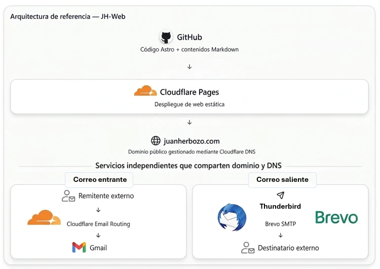

# Infraestructura digital profesional con costes controlados

**Arquitectura práctica, implementación real y documentación técnica reproducible.**

[English](README.md) | [Español](README.es.md)

## Arquitectura de referencia

## Descripción

Construir una presencia digital profesional no siempre requiere infraestructura costosa, múltiples suscripciones o plataformas empresariales complejas.

Este proyecto explora cómo combinar tecnologías existentes y servicios cloud para crear una solución digital mantenible y controlar los costes recurrentes.

Está basado en la implementación real de **JH-Web — Personal Digital Platform**.

## Arquitectura

La solución de referencia incluye:

| Componente | Tecnología | Función |
|---|---|---|
| Web | Astro y TypeScript | Plataforma estática bilingüe |
| Contenidos | Markdown | Proyectos y artículos |
| Versionado | Git y GitHub | Gestión del código |
| Alojamiento | Cloudflare Pages | Publicación de la web |
| Dominio | Cloudflare DNS | Configuración DNS |
| Correo entrante | Cloudflare Email Routing | Reenvío de mensajes |
| Buzón | Gmail | Recepción y almacenamiento |
| Correo saliente | Thunderbird y Brevo SMTP | Envío autenticado |
| Autenticación | SPF, DKIM y DMARC | Autenticación del dominio |

Cada componente cumple una función específica. Su integración no equivale a disponer de una plataforma empresarial completa de correo y colaboración.

## ¿A quién puede resultar útil?

La documentación está orientada a autónomos, profesionales independientes y pequeños negocios con necesidades digitales relativamente sencillas.

Por ejemplo, cafeterías, restaurantes pequeños y negocios de servicios locales.

Las organizaciones que gestionan información sensible o necesitan buzones compartidos, políticas formales de conservación, colaboración avanzada o garantías contractuales de servicio deben evaluar soluciones empresariales específicas.

## Guías de implementación

### Documentación disponible

- [Arquitectura de referencia](docs/es/architecture.md)
- [Guía 01 — Preparación y requisitos](docs/es/guides/01-prerequisites.md)
- [Guía 02 — Astro, GitHub y Cloudflare Pages](docs/es/guides/02-astro-github-cloudflare-pages.md)
- [Guía 03 — Dominio y configuración DNS](docs/es/guides/03-domain-dns.md)

### Próximas guías

Está prevista la publicación de las siguientes guías:

1. Arquitectura y selección de tecnologías
2. Despliegue de una web estática
3. Configuración del dominio y DNS
4. Reenvío de correo mediante Cloudflare
5. Configuración SMTP y autenticación
6. Pruebas, seguridad, mantenimiento y resolución de problemas
7. Análisis de costes y limitaciones

La documentación se incorporará progresivamente después de su revisión técnica.

## Costes y limitaciones

Los planes gratuitos pueden reducir los costes recurrentes, pero no eliminan el coste del dominio, el trabajo administrativo, el mantenimiento ni los riesgos operativos.

Antes de adoptar esta arquitectura deben verificarse los límites, la disponibilidad, el soporte y las condiciones de uso de cada servicio.

Brevo SMTP fue probado técnicamente en la implementación de referencia. Su idoneidad para correspondencia empresarial individual sigue pendiente de confirmación respecto a las condiciones de uso del proveedor.

Este repositorio constituye documentación educativa y no garantiza su idoneidad para cualquier negocio.

## Implementación real

**JH-Web — Personal Digital Platform**

- [Consultar el caso de estudio](https://juanherbozo.com/es/projects/jh-web-personal-digital-platform/)
- [Visitar la plataforma](https://juanherbozo.com/es/)

## Autor

**Juan Herbozo**

Consultor funcional Microsoft Dynamics 365 Business Central

[Web personal](https://juanherbozo.com/es/) | [LinkedIn](https://www.linkedin.com/in/juanherbozo/)

---

Esta es una iniciativa personal e independiente. No representa a mi empresa ni a sus clientes.