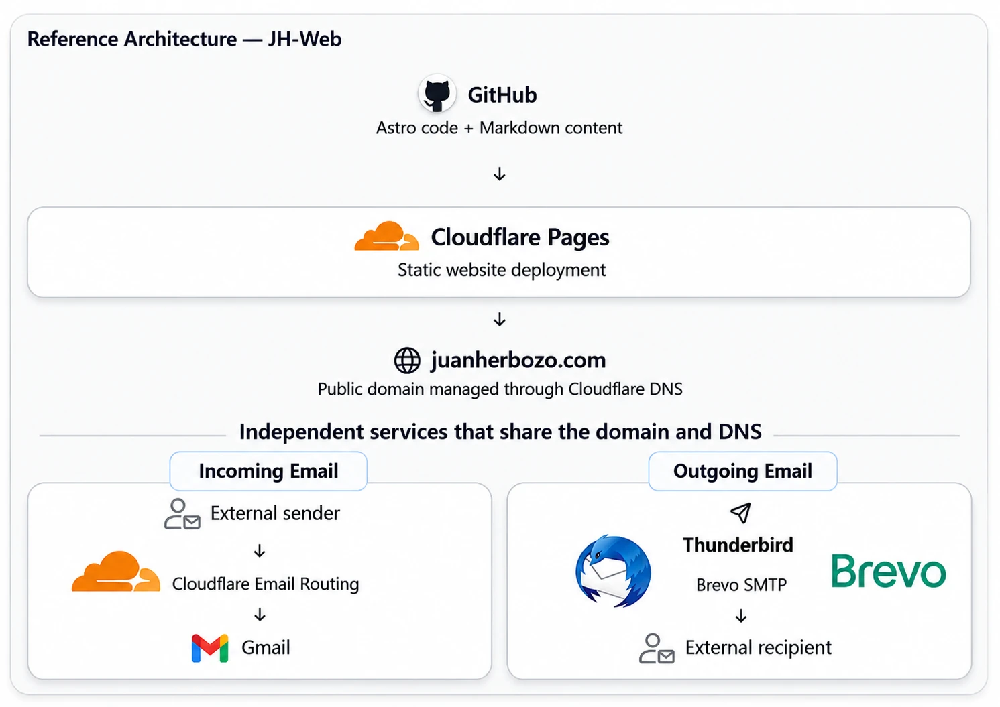

# Professional Digital Infrastructure on a Budget

**Practical architecture, real implementation, and reproducible technical guidance.**

[English](README.md) | [Español](README.es.md)

## Reference Architecture

## Overview

Building a professional digital presence does not always require expensive infrastructure, multiple subscriptions, or complex enterprise platforms.

This project explores how existing technologies and cloud services can be combined to create a maintainable digital presence while keeping recurring infrastructure costs under control.

It is based on the real implementation of **JH-Web — Personal Digital Platform**.

## Architecture

The reference solution includes:

| Component | Technology | Purpose |
|---|---|---|
| Website | Astro and TypeScript | Bilingual static website |
| Content | Markdown | Projects and articles |
| Version control | Git and GitHub | Source management |
| Hosting | Cloudflare Pages | Static website deployment |
| Domain management | Cloudflare DNS | DNS configuration |
| Incoming email | Cloudflare Email Routing | Email forwarding |
| Mailbox | Gmail | Message reception and storage |
| Outgoing email | Thunderbird and Brevo SMTP | Authenticated message sending |
| Email authentication | SPF, DKIM and DMARC | Domain authentication |

These components have different responsibilities. Their integration does not constitute a complete enterprise email or collaboration platform.

## Who is this for?

This documentation may be useful for freelancers, independent professionals, portfolio owners, and small organizations with relatively simple digital infrastructure requirements.

Examples include small cafés, restaurants, and local service businesses.

Organizations handling sensitive information, requiring shared mailboxes, formal retention policies, advanced collaboration, or contractual service guarantees should assess dedicated business solutions.

## Implementation guides

### Available documentation

- [Reference Architecture](docs/en/architecture.md)
- [Guide 01 — Preparation and Prerequisites](docs/en/guides/01-prerequisites.md)
- [Guide 02 — Astro, GitHub and Cloudflare Pages](docs/en/guides/02-astro-github-cloudflare-pages.md)

### Documentation roadmap

The following guides are planned:

1. Architecture and technology selection
2. Static website deployment
3. Domain and DNS configuration
4. Email forwarding with Cloudflare
5. SMTP configuration and authentication
6. Testing, security, maintenance, and troubleshooting
7. Cost analysis and architectural limitations

Documentation will be added progressively after technical review.

## Costs and limitations

Free service tiers can reduce recurring subscription costs, but they do not eliminate domain fees, administrative effort, maintenance, or operational risks.

Service limits, availability, support, and acceptable-use policies must be verified before adopting this architecture.

Brevo SMTP was technically tested for the reference implementation. Its suitability for general individual business correspondence remains subject to confirmation of the provider's permitted-use conditions.

This repository is educational documentation, not a guarantee of suitability for any specific business.

## Real-world implementation

**JH-Web — Personal Digital Platform**

- [View the case study](https://juanherbozo.com/en/projects/jh-web-personal-digital-platform/)
- [Visit the platform](https://juanherbozo.com/en/)

## Author

**Juan Herbozo**

Microsoft Dynamics 365 Business Central Consultant

[Personal website](https://juanherbozo.com/en/) | [LinkedIn](https://www.linkedin.com/in/juanherbozo/)

---

This is an independent personal initiative and does not represent my employer or its clients.