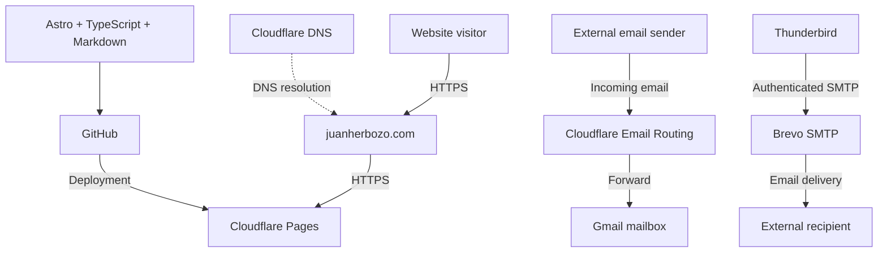

# JH-Web — Editable Reference Architecture

This Mermaid diagram is the editable technical representation of the JH-Web architecture.

For the visual diagrams, see the Spanish and English WebP files in this directory.

## Architecture boundaries

- Cloudflare Pages hosts the static website.
- Cloudflare DNS manages domain resolution and email-related DNS records.
- Cloudflare Email Routing forwards incoming email to Gmail.
- Thunderbird sends messages through Brevo SMTP.
- SPF, DKIM and DMARC support email authentication.

The website hosting and email services operate independently.

## Limitations

This diagram represents the tested JH-Web implementation, not a general-purpose enterprise email architecture.

Technical functionality does not guarantee suitability for every organization or compliance requirement.

The use of Brevo SMTP for general individual professional correspondence remains subject to the provider's acceptable-use conditions.