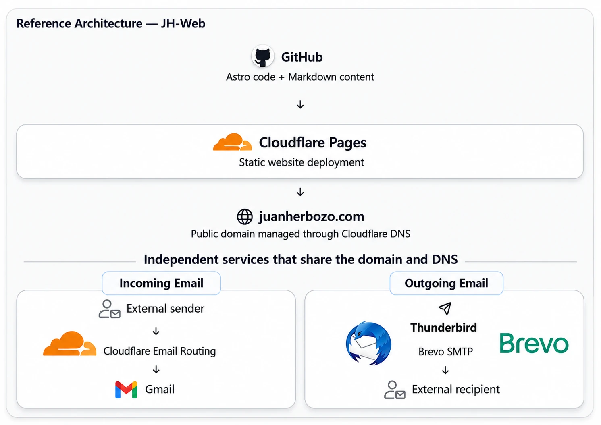

# Reference Architecture

[Home](../../README.md) | [Español](../es/architecture.md)

## 1. Purpose

This document describes the architecture implemented for JH-Web — Personal Digital Platform.

It demonstrates how existing technologies and cloud services can be integrated to build a professional digital presence while controlling recurring costs.

It is a technical reference, not a universal architecture for every business.

## 2. Design principles

The architecture follows these principles:

- Simplicity: introduce only necessary components.
- Separation: keep the website, DNS and email services independent.
- Maintainability: use structured content and version control.
- Security: authenticate email and protect credentials.
- Cost awareness: evaluate free-tier limits before purchasing subscriptions.
- Functional evolution: allow components to evolve independently.

## 3. General architecture

The platform has two operational areas: website publishing and email communication.

They share a domain but operate through independent services.

## 4. Website infrastructure

### Development

Astro and TypeScript support reusable components and static page generation.

Articles and projects are managed as Markdown content in English and Spanish.

### Version control

Git manages local changes, while GitHub stores the repository.

The implemented workflow is:

1. Local changes.
2. Build validation.
3. Change review.
4. Commit and push.
5. Cloudflare Pages deployment.
6. Production verification.

### Hosting and domain

Cloudflare Pages publishes static website assets.

Cloudflare DNS manages the domain records required for website resolution and email services.

The implemented scope does not require a continuously running application server.

## 5. Email architecture

### Incoming email

External sender → Cloudflare Email Routing → Gmail.

Cloudflare receives messages addressed to the configured professional address and forwards them to a verified destination mailbox.

This service does not provide a dedicated IMAP mailbox for the domain.

### Outgoing email

Thunderbird → Brevo SMTP → External recipient.

Thunderbird uses an additional sending identity associated with the Brevo SMTP server.

The personal mailbox retains its independent outgoing server configuration.

### Authentication

DNS records were configured and validated for domain authentication.

An actual message received by Outlook showed:

- SPF: PASS, for the Brevo envelope sender domain.
- DKIM: PASS, signed using the professional domain.
- DMARC: PASS, through DKIM alignment.

A successful test does not guarantee delivery of every future message.

## 6. Decisions and alternatives

| Requirement | Implemented choice | Alternative |
|---|---|---|
| Informational website | Static Astro | CMS or dynamic application |
| Deployment | Cloudflare Pages | Other static hosting |
| Version control | GitHub | Another Git platform |
| Incoming email | Cloudflare Email Routing | Hosted business mailbox |
| SMTP delivery | Brevo | Business email provider |
| Mail client | Thunderbird | Compatible mail client |

Technology selection depends on operational requirements, contractual needs, technical capacity and budget.

## 7. Costs

The implementation uses free service tiers for selected components.

It should not be described as having zero total cost.

Consider:

- Domain registration and renewal.
- Implementation and administration time.
- Maintenance and troubleshooting.
- Changes to service limits, pricing and terms.
- Migration costs when requirements increase.

## 8. Security and limitations

This solution does not automatically provide the full capabilities of Microsoft 365 or Google Workspace.

It does not necessarily include shared mailboxes, contractual availability guarantees, centralized enterprise administration, advanced retention policies or integrated collaboration.

Before using this architecture for a business, assess:

- Personal and confidential data handling.
- Availability and recovery requirements.
- Credential protection and renewal.
- Sending and receiving limits.
- Provider acceptable-use terms.
- Support and continuity requirements.

The use of Brevo's free SMTP service for individual professional correspondence remains subject to explicit confirmation from the provider.

Do not apply this reference architecture to sensitive or critical workflows without a dedicated assessment.

## 9. Validation performed

The JH-Web implementation was tested for:

- Bilingual website publishing.
- Static page generation.
- Authenticated SMTP sending.
- Incoming mail through Cloudflare Email Routing.
- Replies using the professional sending identity.
- SPF, DKIM and DMARC results in a test message.

These tests validate the implemented scenario, not every possible use case.

## 10. Real implementation

[View JH-Web — Personal Digital Platform](https://juanherbozo.com/en/projects/jh-web-personal-digital-platform/)

Detailed configuration instructions will be provided in separate guides.