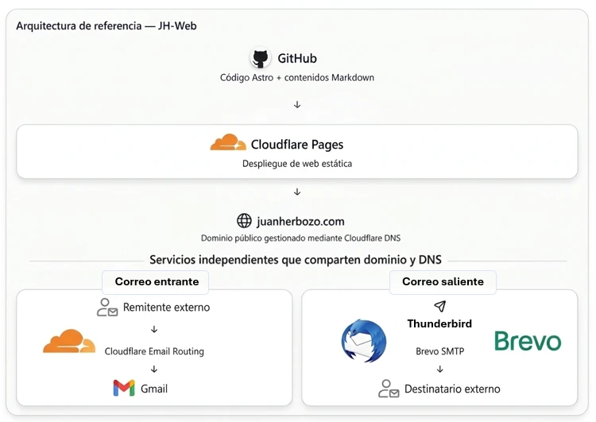

# Arquitectura de referencia

[Inicio](../../README.es.md) | [English](../en/architecture.md)

## 1. Propósito

Esta documentación describe la arquitectura implementada en JH-Web — Personal Digital Platform.

Su objetivo es demostrar cómo integrar tecnologías y servicios cloud existentes para construir una presencia digital profesional con costes recurrentes controlados.

La solución sirve como referencia técnica, no como una arquitectura universal para todos los negocios.

## 2. Principios de diseño

Se adoptaron los siguientes principios:

- Simplicidad: incorporar únicamente los componentes necesarios.
- Separación: mantener independientes la web, los DNS y el correo.
- Mantenibilidad: utilizar contenidos estructurados y control de versiones.
- Seguridad: autenticar el correo y proteger las credenciales.
- Costes: evaluar los límites de los servicios gratuitos antes de contratar suscripciones.
- Escalabilidad funcional: facilitar la evolución de cada componente.

## 3. Arquitectura general

La plataforma tiene dos ámbitos operativos: publicación web y comunicación por correo.

Ambos utilizan el mismo dominio, pero funcionan mediante servicios independientes.

## 4. Infraestructura web

### Desarrollo

Astro y TypeScript permiten implementar componentes reutilizables y generar páginas estáticas.

Los artículos y proyectos se mantienen como contenidos Markdown, con versiones en español e inglés.

### Control de versiones

Git administra los cambios locales y GitHub almacena el repositorio.

El flujo utilizado es:

1. Modificación local.
2. Validación de la compilación.
3. Revisión de los cambios.
4. Commit y push.
5. Despliegue mediante Cloudflare Pages.
6. Verificación del sitio publicado.

### Alojamiento y dominio

Cloudflare Pages publica los archivos estáticos.

Cloudflare DNS administra los registros necesarios para resolver el dominio y configurar los servicios de correo.

La web no necesita un servidor de aplicaciones permanente para el alcance implementado.

## 5. Arquitectura del correo

### Recepción

Remitente externo → Cloudflare Email Routing → Gmail.

Cloudflare recibe mensajes dirigidos a la dirección profesional configurada y los reenvía al buzón de destino verificado.

Este servicio no constituye un buzón IMAP propio del dominio.

### Envío

Thunderbird → Brevo SMTP → Destinatario externo.

Thunderbird utiliza una identidad de correo adicional asociada al servidor SMTP de Brevo.

El buzón personal conserva su configuración de salida independiente.

### Autenticación

Se configuraron y verificaron registros DNS para autenticar el dominio.

En un mensaje real recibido en Outlook se observaron:

- SPF: PASS, para el dominio de retorno de Brevo.
- DKIM: PASS, firmado con el dominio profesional.
- DMARC: PASS, gracias a la alineación DKIM.

Un resultado satisfactorio en esta prueba no garantiza la entrega de todos los mensajes futuros.

## 6. Decisiones y alternativas

| Necesidad | Decisión aplicada | Alternativa |
|---|---|---|
| Web informativa | Astro estático | CMS o aplicación dinámica |
| Despliegue | Cloudflare Pages | Otro hosting estático |
| Control de cambios | GitHub | Otra plataforma Git |
| Recepción de correo | Cloudflare Email Routing | Buzón profesional alojado |
| Envío SMTP | Brevo | Servicio de correo empresarial |
| Cliente de correo | Thunderbird | Cliente compatible con el proveedor |

La elección depende de necesidades operativas, requisitos contractuales, capacidad técnica y presupuesto.

## 7. Costes

La implementación aprovecha planes gratuitos para determinados servicios.

No debe describirse como una solución de coste total cero.

Deben considerarse:

- Registro y renovación del dominio.
- Tiempo de implementación y administración.
- Mantenimiento y resolución de incidencias.
- Posibles cambios en límites, precios y condiciones.
- Migración a servicios de pago si aumentan las necesidades.

## 8. Seguridad y limitaciones

Esta solución no ofrece por sí misma todas las funciones de Microsoft 365 o Google Workspace.

No incluye necesariamente buzones compartidos, garantías contractuales de disponibilidad, administración empresarial centralizada, políticas avanzadas de retención ni herramientas integrales de colaboración.

Antes de adoptarla para un negocio se deben evaluar:

- Tratamiento de datos personales y confidenciales.
- Requisitos de disponibilidad y recuperación.
- Protección y renovación de credenciales.
- Límites de envío y recepción.
- Condiciones de uso de los proveedores.
- Necesidades de soporte y continuidad.

El uso del SMTP gratuito de Brevo para correspondencia profesional individual sigue pendiente de confirmación expresa del proveedor.

No se recomienda extrapolar esta configuración a procesos críticos o sensibles sin una evaluación específica.

## 9. Validación realizada

En JH-Web se comprobaron:

- Publicación de la web bilingüe.
- Generación de las páginas estáticas.
- Envío SMTP autenticado.
- Recepción mediante Cloudflare Email Routing.
- Respuesta desde la identidad profesional.
- Resultados SPF, DKIM y DMARC en un correo de prueba.

Estas pruebas validan el escenario implementado, no todos los posibles escenarios de uso.

## 10. Implementación real

[Consultar JH-Web — Personal Digital Platform](https://juanherbozo.com/es/projects/jh-web-personal-digital-platform/)

La documentación de configuración detallada se incorporará en guías independientes.